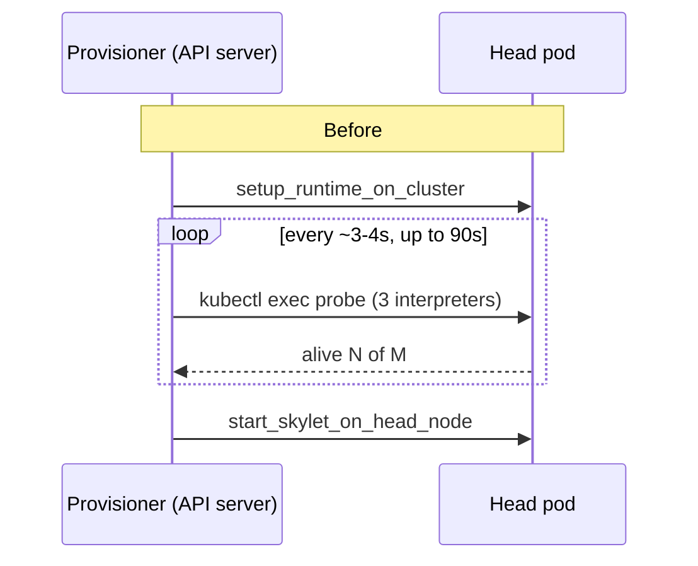
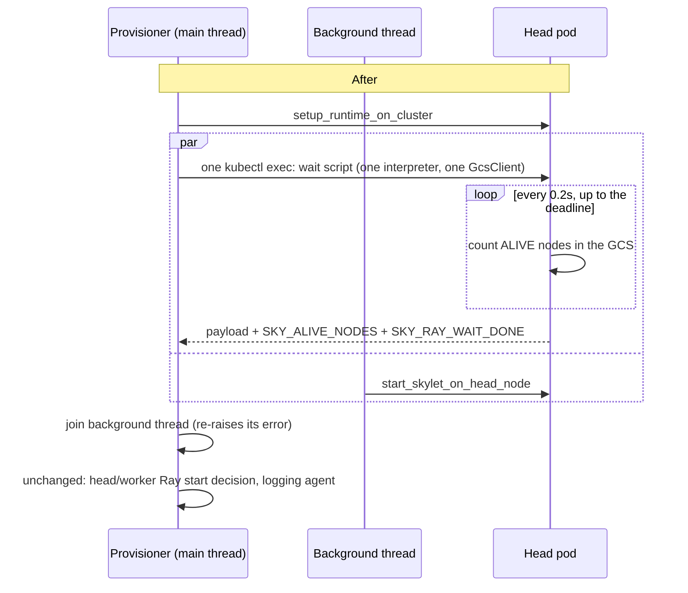

# Design: Blocking Ray wait and overlapped skylet startup for K8s launches

- **Branch:** `ej-prj-1`
- **Status:** Implemented, with unit tests passing and measured on `kind-skypilot`.
- **Related:** `ej/scheduling_latency_analysis.md`. This doc implements ideas #2 and #3 from it.

## 1. Background

When SkyPilot launches a new cluster on Kubernetes, each pod starts Ray by itself: the pod startup script in `sky/templates/kubernetes-ray.yml.j2` installs dependencies and then runs `ray start`. The provisioner, running in the API server, has to wait until every pod's Ray has joined the head. Only then can it skip starting Ray itself and hand the cluster over for job submission.

The latency analysis of `ej/oct27_1039.log` (and the other runs in `ej/`) found that this wait took **61–67% of every launch**. Two parts of the old implementation made it worse.

1. **The wait was a polling loop with expensive probes.** `_post_provision_setup()` called `check_ray_port_and_cluster_healthy()` once per second. Each call ran `RAY_ALIVE_NODE_COUNT_COMMAND` through `kubectl exec`, and that command started three Python interpreters: one to read the port file, one importing `sky` to encode the payload, and one importing `ray._raylet` to count nodes. Each probe took 2.3–4 s. The provisioner therefore found out the cluster was ready up to a whole probe late, and paid the exec and interpreter cost again on every round.
2. **Skylet startup ran after the wait.** `start_skylet_on_head_node()` (about 1.6 s) only ran once every worker had joined. It only needs the head pod and the SkyPilot runtime that `setup_runtime_on_cluster()` installs, so it could run earlier.



## 2. Goals and non-goals

### Goals
- Notice that the Ray cluster is ready within about 0.2 s of the last worker joining, instead of up to a whole probe late.
- Take skylet startup off the critical path of a fresh K8s launch.
- Keep everything that happens after the wait exactly as it was:
  - the exact-count health rule (`alive == num_nodes`, not `>=`);
  - the 90 s fallback that starts Ray from the provisioner;
  - workers started with `no_restart=True` when the head is up but a worker is missing;
  - the port reported to the workers.
- Need no API-version change and no change to images or pod templates.

### Non-goals
- Starting Ray earlier inside the pod (idea #1 in the analysis). That needs changes to the pod startup script and the image, and is left for a follow-up.
- Changing re-launches of an existing cluster (the "not just booted" path), or non-K8s clouds. Both keep the single `check_ray_port_and_cluster_healthy()` probe.

## 3. Design

### 3.1 Overview



### 3.2 Component 1: The blocking wait on the head (idea #2)

**Where:** `sky/provision/instance_setup.py`, in `_WAIT_ALIVE_NODES_PY`, `ray_wait_for_alive_nodes_command()`, `RAY_WAIT_DONE_MARKER` and `_RAY_WAIT_POLL_INTERVAL_SECONDS`.

The provisioner makes one remote call that runs a small Python script on the head. The script loops until the cluster is complete or the deadline passes. On each round it:

1. **Reads the Ray port** from `$SKY_RUNTIME_DIR/.sky/ray_port.json`, and falls back to `SKY_REMOTE_RAY_PORT` if the file is missing. It re-reads the file every round, because the head writes it only after `ray start --head` returns.
2. **Checks that the port accepts a TCP connection.** This is cheap and avoids importing Ray while nothing is listening yet.
3. **Opens one `GcsClient` and keeps it** for the rest of the wait. It opens a new client only if the port changes or a query fails.
4. **Counts nodes in the ALIVE state** (`state == 0`). It handles both the Ray 2.9.3 dict form and the Ray 2.56.1 `GcsNodeInfo` form, as the existing probe does.
5. **Stops** when `alive == expected` or when the deadline would pass before the next round. Otherwise it sleeps 0.2 s.

**Output contract.** The wait reports in the same format as `RAY_ALIVE_NODE_COUNT_COMMAND`, so the existing parsing code is reused:

| Output | Meaning |
|---|---|
| `<sky-payload>{"ray_port": N}</sky-payload>` | The port to tell workers. Always printed. |
| `SKY_ALIVE_NODES <alive> <total>` | Printed when the last GCS query succeeded. |
| `Ray cluster is not found at 127.0.0.1:N` | Printed when nothing was listening on the port. Same text as the existing probe. |
| `SKY_RAY_WAIT_DONE` (last line) | **New.** The script ran to the end. |
| Exit code 0 / 1 | 0 if the GCS answered (the head needs no restart); 1 otherwise. |

**Constraints on the script:**
- **Standard library and `ray` only, no `sky`.** The pod startup may still be reinstalling SkyPilot at this point (PyPI version, then the dev wheel). The existing port reader avoids importing `sky` for the same reason.
- **Sent base64-encoded** inside `python -c "exec(base64.b64decode('…'))"`. That way it stays one shell word through every command runner's quoting, and the indentation of a multi-line script can't break. Its parameters (expected nodes, timeout, poll interval, runtime-dir variable name, port file, default port) are passed as `argv`.

**Provisioner side.** `wait_for_ray_cluster_healthy(timeout)` is a new function inside `_post_provision_setup` in `sky/provision/provisioner.py`. It:

- issues the call with the remaining time as the script's deadline;
- sets a local timeout of `remaining + 30 s` (`_RAY_WAIT_CALL_SLACK_SECONDS`), so a stuck `kubectl exec` stream can't hang the launch forever;
- treats output **without** `SKY_RAY_WAIT_DONE` as a dropped connection, not as Ray being down, and retries after 1 s with the time left, until the overall deadline of 90 s (`_K8S_RAY_READY_TIMEOUT_SECONDS`);
- passes the final output to `parse_ray_probe()`. That function was split out of `check_ray_port_and_cluster_healthy()` so both functions return `(ray_port, ray_cluster_healthy, head_ray_needs_restart)` with the same rules.

### 3.3 Component 2: Skylet startup during the wait (idea #3)

**Where:** `_run_alongside()` and the K8s just-booted branch of `_post_provision_setup()`, both in `sky/provision/provisioner.py`.

```python
(ray_port, ray_cluster_healthy, head_ray_needs_restart) = _run_alongside(
    lambda: wait_for_ray_cluster_healthy(_K8S_RAY_READY_TIMEOUT_SECONDS),
    start_skylet)
skylet_started = True
...
if not skylet_started:
    start_skylet()   # all other paths: unchanged position
```

`_run_alongside(main, background)` behaves as follows:

- **Runs `background` in a one-thread `ThreadPoolExecutor`** while `main` runs in the calling thread.
- **Passes the provision log path to the thread.** `provision_logging.config` is a `threading.local`. Without this step, `start_skylet_on_head_node()` would write its command output to `/dev/null` instead of `provision.log`.
- **Runs the thread in `contextvars.copy_context()`**, so the API server's per-request context (config overrides, cancellation) applies there too.
- **Joins the thread before returning**, and re-raises its error after `main` returns. A skylet failure still fails the launch, as before. If `main` raises, the `with` block still waits for the thread to finish, so no skylet `kubectl exec` is left running behind a teardown. `start_skylet_on_head_node` has its own timeout and retries, so that wait is bounded.

**Why it's safe to start skylet before every worker has joined:**
- Skylet's startup (`sky.skylet.attempt_skylet`) doesn't use Ray. Ray is used only by the autostop handler, much later.
- Skylet only needs the dev wheel, which `setup_runtime_on_cluster()` has already installed. That step also waits for the pod's own install step to finish (the `ray_skypilot_installation_complete` marker in `kubernetes-ray.yml.j2`).
- No job can be submitted until `_post_provision_setup()` returns, which happens after both the wait and skylet startup have finished.
- If the wait times out and Ray is restarted on the head, `ray stop` only matches Ray's own processes, not `python -m sky.skylet.skylet`.
- The logging agent setup now runs after skylet startup rather than before it. Neither depends on the other.

## 4. Failure handling

| Situation | Before | After |
|---|---|---|
| All nodes join | Seen on the next probe (up to about 4 s late) | Seen within about 0.2 s |
| Head GCS port open but not answering yet | Probe fails, loop retries | Script catches the error and retries with a new client |
| A worker never joins within 90 s | Workers started with `no_restart=True` | Same: exit 0 with a partial count |
| No Ray on the head after 90 s | Ray started on head and workers | Same: exit 1, "not found" |
| `kubectl exec` drops mid-wait | That probe looks like "head down"; the next probe retries | Missing done marker, so the call is retried for the time left. It doesn't cause a Ray restart. |
| `kubectl exec` hangs | Each probe call unbounded | Bounded by `remaining + 30 s` |
| Skylet fails to start | Launch fails at the end | Launch fails once the wait returns |
| Re-launching an existing cluster | Single probe | Unchanged |
| Non-K8s clouds | Unchanged | Unchanged |

## 5. Compatibility

- **API, client and server:** no wire-format or API change, so `API_VERSION` stays the same.
- **Cluster images:** the script needs only the runtime's Python (3.7+ syntax) and `ray._raylet.GcsClient`, which the existing probe already relies on. It works with images that already exist; nothing new has to be on the pod.
- **Clusters that already exist:** not affected. The new path runs only when the head pod was just created.

## 6. Testing

### Unit tests

The new file is `tests/unit_tests/test_sky/provision/test_provisioner_ray_wait.py`, with 12 tests in two groups.

**The real wait script,** run against a local socket and a fake `ray._raylet`:
- returns as soon as every node has joined, well before the deadline;
- keeps going while the GCS port is open but queries fail;
- at the deadline, reports the partial count with exit 0;
- when nothing is listening, prints "not found", exits 1, and still prints the port and the done marker;
- falls back to the default port when the port file is missing;
- the command ships the exact script as one shell word, with the right arguments.

**The provisioner on a just-booted K8s cluster:**
- a ready cluster takes exactly one blocking call, no Ray start, and one skylet start;
- skylet runs while the wait is in progress (the wait blocks until skylet has started), and logs to the provision log;
- a dropped exec is retried rather than treated as Ray being down;
- workers that never join are started with `no_restart=True` and the right port;
- with no Ray on the head, Ray is started everywhere and skylet still starts only once;
- a skylet failure still fails the launch.

The existing tests still pass: `test_provisioner_ray_port.py`, `test_ray_health_check_source.py` and the rest of `tests/unit_tests/test_sky/provision/`. The changed files pass mypy and pylint (10.00/10) and are formatted with yapf and isort.

### End-to-end on kind

These were three launches of `ej/job.yaml` (4 nodes, `k8s/kind-skypilot`) on a restarted local API server. All three ran the task on ranks 0–3. The provision logs are saved as `ej/after_ray_wait_run{1,2,3}.log`.

| Run | Total provisioning | Runtime installed → launch done |
|---|---|---|
| Before: `oct27_1022` | 27.1 s | 19.2 s |
| Before: `oct27_1033` | 29.9 s | 21.9 s |
| Before: `oct27_1039` | 23.1 s | 15.6 s |
| Before: `oct30_1022` | 30.2 s | 21.8 s |
| **Before, mean** | **27.6 s** | **19.6 s** |
| After: run 1 | 24.9 s | 17.5 s |
| After: run 2 | 25.5 s | 13.8 s |
| After: run 3 | 20.6 s | 12.9 s |
| **After, mean** | **23.7 s** | **14.7 s** |

How to read these numbers:
- The segment these changes target (from the runtime being installed to the launch finishing) went from about **19.6 s to 14.7 s, roughly 25% faster**. Total provisioning went from **27.6 s to 23.7 s, roughly 14% faster**.
- The samples are small (4 runs before, 3 after) and pod startup on kind varies by several seconds from run to run, so treat these as directional.
- What's left of the wait is the pods' own Ray startup, which is idea #1. Skylet startup now takes 3.4–3.9 s instead of 1.6 s because it competes for CPU with the pods' Ray startup on the same kind node. It's no longer on the critical path, so this doesn't affect the totals.

### Before merging

- Run `/smoke-test --kubernetes`. This path is shared by every K8s launch, including the jobs and serve controllers.
- Test a multi-node launch with `--image-id` set to a non-default image, and in host-network mode.

## 7. Risks

- **The wait holds one `kubectl exec` open for up to 90 s.** Some proxies drop idle exec streams. The script prints nothing until it finishes, so such a drop shows up as a missing done marker and is retried, but each retry costs an exec plus an interpreter start. If this happens in practice, print a heartbeat line from the script.
- **More happens at once on the head while Ray starts:** skylet startup runs alongside the pods' own Ray startup. That's harmless on the clusters tested, but on very small pods (less than 1 CPU) it could slow Ray startup slightly.
- **Two copies of the port-reading logic** now exist: `_READ_RAY_PORT_PY` and the wait script. They follow the same rules. If the port file format changes, update both.

## 8. Follow-up work

1. Idea #1 from the analysis: stop installing SkyPilot from PyPI during pod startup, build the setuptools pin and Ray patches into the image, and start Ray first. This targets the rest of the wait.
2. Use `imagePullPolicy: IfNotPresent` for pinned image tags, to cut about 3–4 s of pod startup on local clusters.
3. Consider moving `internal_file_mounts` and the head's `setup_runtime_on_cluster` to start as soon as the head pod is running, instead of waiting for all pods.
